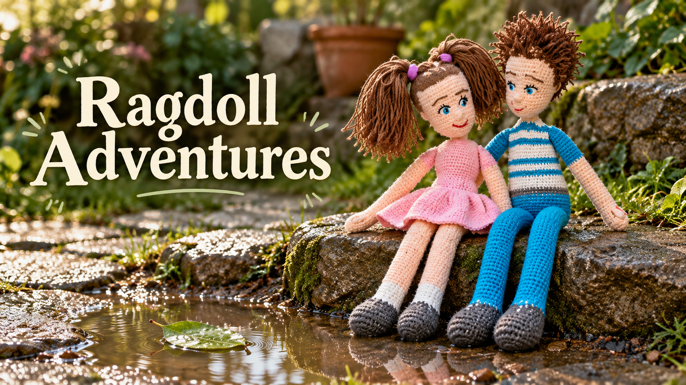

# Ragdoll Adventures

Two unnamed handmade rag-doll siblings share warm adventures through their own dialogue, in **photorealistic real-world surroundings**.

**First one-minute test exported on 25 October 2026:** *The Leaf Boat - One Minute Test*, saved in the owner's VideoExpress account under My Videos. Owner review of performance and lip-sync is the next step; the full five-minute episode has not been produced.

## Production format

- Unnamed sister and brother; internal labels never become spoken names.
- Original crochet identities, yarn texture, pink dress, purple pigtail ties and turquoise stripes.
- Real-looking gardens, stone paths, water, plants, lighting and shadows. No animated or illustrated environments.
- Character dialogue only; no narrator.
- Ana for sister and Justin for brother, approved by the owner. Reference samples remain private.
- Each spoken/TTS line: **at most 100 characters including spaces and punctuation**.
- Each clip: **at most 10 seconds**. The test uses 8–9 second settings.
- Test runtime: **59.93 seconds** as reported by the exported video's browser playback metadata.
- Longer episodes: 3–5 purposeful chapters, a five-minute target, no stretched footage or repetitive padding. Expand only after reviewing the short test.

## Workflow files

[Operating workflow](SYSTEM_PROMPT.md) · [Character Bible](ragdoll-adventures/CHARACTERS.md) · [Voice Setup](ragdoll-adventures/VOICES.md)

All series assets live under [ragdoll-adventures/](ragdoll-adventures/). Source photographs, private audio samples and unpublished videos stay in the owner's account or private storage. This public fork contains workflow documentation and the authorized banner.

[Back to Ivor's private Workflow Library](https://github.com/builtbyivor-bot/workflow-library)

## Origin

Adapted from [ai-playbooks/slow_english_learning_videos](https://github.com/ai-playbooks/slow_english_learning_videos), upstream commit 5657b8e785f4e1fe722565c83349a6abf301dc66. The adaptation replaces generic slow-English characters and prompt-only voices with the owner's unnamed crochet siblings, real-world settings and saved voice samples. Upstream history is retained.
