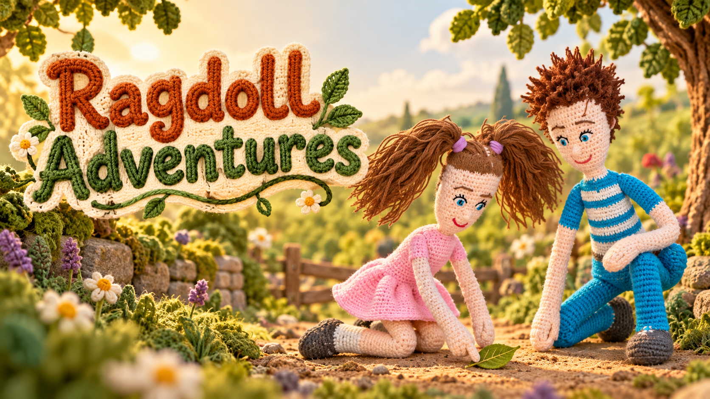

# Ragdoll Adventures

Two unnamed handmade crochet siblings share animated adventures through their own dialogue: Ana for sister, Justin for brother.

## Approved reference

**The Leaf Boat - Animated Garden Test** defines the approved animation style, soft character finish and varied visual storytelling. Its individual scenery/action continuity still needs correction. Preserve its look while fixing those details.

**The Leaf Boat - Continuity Revision is rejected.** Its more realistic scenery, rugged character finish, repeated fixed composition and static story are not the series template. Earlier photorealistic directions are superseded. See the [style lock](ragdoll-adventures/STYLE_LOCK.md).

## Video factory

1. Plan a visible beginning, complication and payoff, with purposeful action and varied shots in a mapped location.
2. Lock the approved look, character identities, voices, geography and props before generation.
3. Check keyframes, actual motion and processed audio. Reject failures without rewriting the story or changing the style to excuse them.
4. Cut tightly around speech/action, recheck every join, save/reopen the populated editable timeline and inspect the internal export when needed.
5. Present owner review only after required checks pass. Download video to the PC only after explicit final 100% approval.

Every finished clip is **≤10 seconds**. Every literal spoken/TTS line is **≤100 characters including spaces and punctuation**. No narrator, padding, stretched footage or unexplained quiet holds. A coherent location allows different camera angles and purposeful character movement.

**Current milestone: write a 35-second proof after updating this workflow.** The factory is not yet validated for unattended production. Five-minute episodes follow a successful short production/review cycle, using 3–5 purposeful chapters.

## Workbook and checks

- [Operating workflow](SYSTEM_PROMPT.md)
- [Approved visual and storytelling lock](ragdoll-adventures/STYLE_LOCK.md)
- [Factory stages, cutting rules and acceptance gates](ragdoll-adventures/FACTORY.md)
- [Continuity and literal action checks](ragdoll-adventures/CONTINUITY.md)
- [Character Bible](ragdoll-adventures/CHARACTERS.md) · [Voice Setup](ragdoll-adventures/VOICES.md) · [Proof status](ragdoll-adventures/PILOT.md)
- [Private run-record template](templates/episode.json) · [Record validator](tools/validate_episode.py)

The validator blocks invalid numeric limits and missing review evidence; it does not inspect pixels or listen to audio. Actual media review remains required. Keep filled run records, source photographs, voice samples/IDs and unpublished media private. Banners are branding, never replacement production references.

[Back to Ivor's private Workflow Library](https://github.com/builtbyivor-bot/workflow-library)

## Origin

Adapted from [ai-playbooks/slow_english_learning_videos](https://github.com/ai-playbooks/slow_english_learning_videos), upstream commit 5657b8e785f4e1fe722565c83349a6abf301dc66. Upstream history is retained. Current owner requirements take precedence over generic source characters, narration, scenery and review shortcuts.
